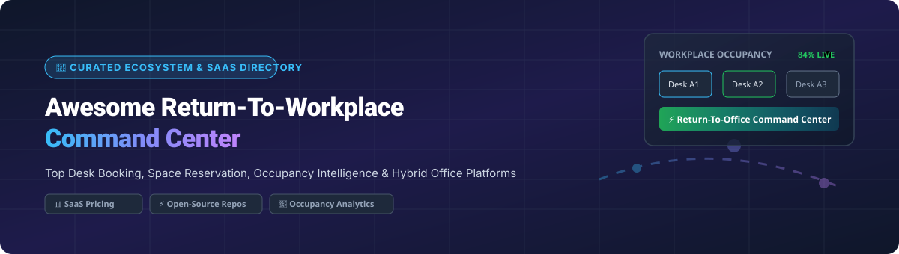

  
  
  
  
  

# 🏢 Awesome Return-To-Workplace Command Center

> **Curated directory of top commercial SaaS platforms and open-source software for Return-To-Office (RTO) operations, desk booking & reservation, workplace occupancy tracking, space management, and hybrid office analytics.**

---

## 📌 Table of Contents

- [📊 Sector Overview & Market Size](#-sector-overview--market-size)
- [💼 Commercial SaaS & Hosted Platforms](#-commercial-saas--hosted-platforms)
- [🔓 Open-Source GitHub Repositories](#-open-source-github-repositories)
- [🤝 How to Contribute](#-how-to-contribute)
- [⚠️ Privacy & Compliance Disclaimer](#️-privacy--compliance-disclaimer)
- [💖 Support & Sponsorship](#-support--sponsorship)
- [⭐ Star History](#-star-history)

---

## 📊 Sector Overview & Market Size

> **Market Valuation & Dynamics**: The Global Workplace Management & Desk Booking Software Market is estimated at **$5.8 Billion in 2026** and projected to reach **$9.4 Billion by 2030** (CAGR ~12.5%). The sector is **moderately fragmented**, with enterprise suite leaders (Salesforce, ServiceNow, Eptura) catering to global corporate IT operations, while specialized category leaders (Envoy, Robin, Kadence, Density, VergeSense) and self-hosted open-source stacks compete for agile, hybrid-first office deployments.

---

## 💼 Commercial SaaS & Hosted Platforms

*Below is a comprehensive comparison of leading commercial workplace command centers, desk booking platforms, and occupancy intelligence solutions, **sorted by company valuation / scale (descending)**.*

| 🏢 Platform | 📝 Description & Key Features | 💵 Specific Starting Pricing | 🎁 Free Tier / Free Trial Details | 📊 Enterprise Scale / Valuation |
| :--- | :--- | :--- | :--- | :--- |
| **[Salesforce Workplace Command Center](https://www.salesforce.com/)** | Reopening hub with employee wellness surveys, shift scheduling, facility preparedness tracking, and public health data integration. | **$5.00 / user / month** (requires base Salesforce CRM / Platform license) | **30-day free trial** of Salesforce Platform; 300 free survey responses included with Enterprise Edition | **~$280 Billion Valuation** ($35B+ Annual Revenue) |
| **[ServiceNow Workplace Service Delivery](https://www.servicenow.com/)** | End-to-end workplace operations, space reservations, visitor management, indoor mapping, and automated facility case management. | **$10.00 / user / month** (as part of ServiceNow WSD / ESM suite) | **15-day developer sandbox** & 30-day enterprise evaluation instance | **~$170 Billion Valuation** ($10B+ Annual Revenue) |
| **[Eptura Workplace](https://eptura.com/)** | Unified workplace management platform (combining iOFFICE, SpaceIQ, and Condeco), live desk & room utilization, AI space planning. | **$2.50 / desk / month** (or $150 / location / month base) | **14-day full-feature trial** on request for up to 50 seats | **~$2.5 Billion Valuation** ($350M+ Revenue) |
| **[Envoy Protect](https://envoy.com/)** | Workplace safety, capacity management, employee health screening questionnaires, touchless sign-in, and arrival analytics. | **$3.00 / user / month** (or $99 / location / month Standard) | **14-day free trial** with unlimited users and desks | **~$1.4 Billion Valuation** ($100M+ Revenue) |
| **[Density OpenPath](https://www.density.io/)** | Hardware + software occupancy intelligence, real-time anonymous people counting sensors, meeting room utilization dashboards. | **$99.00 / sensor / month** ($1,200 / sensor / year) | **30-day risk-free hardware trial** & pilot program up to 5 sensors | **~$1.05 Billion Valuation** (Unicorn Status) |
| **[Condeco](https://www.condeco.com/)** | Flexible desk and room booking platform with interactive floorplans, meeting room status panels, and proximity check-in. | **$3.00 / desk / month** ($35 / user / year) | **14-day free trial** for up to 25 desks | **~$400 Million Valuation** (Part of Eptura Group) |
| **[VergeSense Occupancy](https://www.vergesense.com/)** | Optical occupancy sensors paired with Large Spatial AI Models trained on 250M+ sq ft for real-time desk utilization analysis. | **$15.00 / sensor / month** (or $0.15 / sq ft / year) | **30-day sensor pilot kit** (up to 10 sensors & full dashboard access) | **~$400 Million Valuation** ($80M+ Total Funding) |
| **[Robin Return-to-Office](https://robinpowered.com/)** | Hybrid office scheduling, interactive desk booking, automatic schedule sync, and workplace attendance trend reporting. | **$3.50 / desk / month** (or $119 / month Starter plan) | **14-day free trial** for up to 50 desks and unlimited users | **~$250 Million Valuation** ($45M+ Total Funding) |
| **[OfficeRnD](https://www.officernd.com/)** | Flexible workspace & desk management for hybrid teams and coworking spaces, resource pricing & occupancy dashboards. | **$2.95 / desk / month** ($59 / month for up to 20 desks) | **14-day free trial** with no credit card required | **~$120 Million Valuation** ($20M+ Revenue) |
| **[Kadence](https://kadence.co/)** | Hybrid desk booking, multi-day space reservations, Neighborhood Scheduler for team alignment, and AI desk assignments. | **$2.50 / user / month** ($50 / month base plan) | **14-day free trial** for up to 50 team members | **~$60 Million Valuation** ($13M+ Total Funding) |

---

## 🔓 Open-Source GitHub Repositories

*Self-hosted open-source software, desk reservation tools, and occupancy detection projects, **sorted by GitHub Star Count (descending)**.*

- **[Area Occupancy Detection](https://github.com/Hankanman/Area-Occupancy-Detection)**   
  🧠 **Home Assistant integration to accurately and intelligently track occupancy** of office areas, rooms, and workspaces using multi-sensor topology-aware rules and real-time state engine.

- **[WARP (Workspace Autonomous Reservation Program)](https://github.com/sebo-b/warp)**   
  🚀 **Comprehensive open-source hybrid workspace reservation system**. Supports desk & parking stall booking, visual interactive floor plans with zones, SAML 2.0 / LDAP / Azure AD / OIDC SSO, iCal feed subscriptions, PWA support, auto-booking, and Excel reports.

- **[OpenDesk](https://github.com/kanwalnainsingh/OpenDesk)**   
  💻 **Open-source microservices-based desk reservation system** for hybrid offices. Allows site layout creation, date-wise desk capacity allocation, employee booking dashboards, and reservation alerts.

- **[Mensam](https://github.com/jumper149/mensam)**   
  🪑 **Open-source desk-booking web application** for modern hybrid teams looking to reserve seats and workplace equipment efficiently.

- **[Simple Desk Booking](https://github.com/opariltay/simple-desk-booking)**   
  📅 **Lightweight full-day seat booking software** enabling fast return-to-office workspace planning and simple seat reservations.

- **[Book a Seat](https://github.com/pafavero/book_a_seat)**   
  🎨 **React-based space management and desk reservation app** designed for office seat assignment and hybrid workplace planning.

- **[Office Desk Booking with Apps Script](https://github.com/devoteam-g-cloud/Office-Desk-Booking-with-Apps-Script)**   
  📊 **Google Workspace & Apps Script solution** for flexible office desk reservations and Covid/RTO capacity management.

- **[Occupi](https://github.com/COS301-SE-2024/occupi)**   
  🔮 **AI-powered office occupancy prediction & analytics platform**. Features daily occupancy forecasting, real-time desk tracking, cross-platform apps (web/mobile/desktop), and Go backend.

---

## 🛠️ Frameworks & Additional Open-Source Options

For custom workplace command center development, consider these modular components:
- **[Zulip](https://github.com/zulip/zulip)** — Open-source team chat for real-time office operational announcements.
- **[Nextcloud](https://github.com/nextcloud/server)** — Self-hosted collaboration and office document management.
- **[Outline](https://github.com/outline/outline)** — Team knowledge base for workplace safety policies and RTO guidelines.
- **[BookStack](https://github.com/BookStackApp/BookStack)** — Lightweight wiki for facility operation procedures.
- **[Odoo](https://github.com/odoo/odoo)** — Open-source ERP with HR and facility management modules adaptable for workplace operations.

---

## 🤝 How to Contribute

Contributions are welcome! Help us keep this directory accurate and updated:

1. 🍴 **Fork** this repository.
2. 📝 **Add or edit** entries in `README.md` following the table or list format.
3. 🔗 **Include**: Product name, official link, starting pricing, free trial terms, and factual description.
4. 🚀 **Submit a Pull Request** with a brief summary of additions.

Refer to [Awesome Lists guidelines](https://github.com/ishandutta2007/Awesome-Awesome-Awesome) for contribution standards.

---

## ⚠️ Privacy & Compliance Disclaimer

- 🔒 **Data Privacy & Compliance**: Workplace command centers process sensitive employee information (attendance, desk location, check-in timestamps, health survey logs). Implement strong access controls and adhere to GDPR, CCPA, and HIPAA compliance.
- 👁️ **Transparent Occupancy Intelligence**: Prefer privacy-preserving telemetry (e.g. thermal sensors, anonymous badge taps) over invasive video surveillance.
- 📜 **Licensing Verification**: Review software licenses (AGPL, MIT, Apache 2.0) before deploying self-hosted components in production environments.

---

## 💖 Support & Sponsorship

Thank you for visiting **Awesome Return-To-Workplace Command Center**! 🌟

If you find this repository helpful for your office reopening, desk booking, or workplace management research, please consider supporting the project:

- ⭐ **Star this repository** to help others discover it.
- 🍴 **Fork it** to contribute new platforms, features, or updates.
- 📢 **Share it** with your colleagues, dev teams, and workplace operations community.
- ☕ **Buy me a coffee**: Support ongoing maintenance and curated developer resources via the [GitHub Sponsor Dashboard](https://github.com/sponsors/ishandutta2007).

---

## ⭐ Star History

